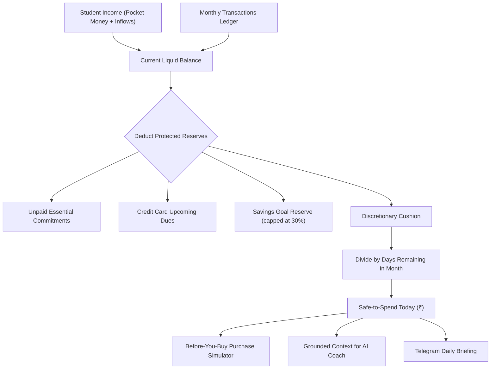
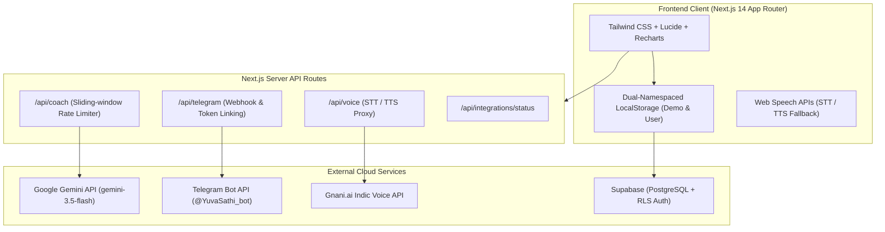

# YUVA SATHI (युवा साथी)
### Your money. Your life. Your साथी.

> An intelligent student financial companion that helps Indian college students make smarter financial decisions, manage daily spending, build savings habits, discover scholarships, and find verified earning opportunities.

---

### 🌐 Live Deployment & Evaluator Links

- 🌐 **Live Web Application:** [https://yuva-sathi-three.vercel.app](https://yuva-sathi-three.vercel.app)
- 🤖 **Telegram Bot:** [@YuvaSathi_bot](https://t.me/YuvaSathi_bot)

---

## 1. The Problem

Indian college students face a unique and persistent set of money challenges:
1. **Lump-Sum Allowance Anxiety:** Monthly pocket money (typically ₹5,000 to ₹15,000) often runs out in the first 10–12 days due to untracked quick-commerce orders (Blinkit, Zepto), daily canteen chai/snacks, and food delivery apps.
2. **Commitment Blindness:** Fixed essential dues (hostel mess fees, semester books, exam forms, and prepaid 5G recharges) are frequently forgotten until the due date, causing high stress and emergency borrowing.
3. **Credit & PayLater Traps:** Easy-to-get digital student credit/paylater cards (OneCard, Slice) lead to interest spirals when dues are not quarantined from daily spending funds.
4. **Guilt vs Practical Guidance:** Conventional finance apps either shame users with alarming red banners or push foreign investment concepts (401k, US equities, dollar denominations) completely divorced from Indian campus life.
5. **Missed Opportunities:** Students miss out on government and corporate scholarships because application deadlines are scattered across disparate portals, while legitimate part-time campus gigs and internships remain hard to find.

---

## 2. Our Solution

**YUVA SATHI** is more than an expense tracker. It is a comprehensive financial and campus life companion designed around genuine student realities.

The core differentiator:
> **Instead of only showing students where their money went, YUVA SATHI helps them decide what they can responsibly do next.**

The platform combines deterministic financial intelligence with opportunity discovery:
- **Know Your Money:** Understand exact available funds and protected buffers.
- **Safe Daily Spending:** Real-time calculation of how much is safe to spend today in INR.
- **Before You Buy:** Simulate any intended purchase before tapping UPI to assess budget impact.
- **Save More:** Set tangible goals with realistic monthly reserve allocations.
- **Earn More:** Discover authentic Indian scholarships and verified flexible student work.

---

## 3. Key Features

### 💰 Financial Dashboard
- **Current Available Balance:** Real-time liquid balance (monthly income minus total expenses so far).
- **Safe-to-Spend Today:** The core metric. Discretionary cushion divided evenly over the remaining days of the month after reserving funds for upcoming essential bills, credit dues, and active savings goals.
- **Spending Pace & Burn Rate:** Transparent indicators (`On Track`, `Frugal`, `Fast`, `Critical`) reflecting variable spending rate.
- **Month-End Forecast:** Linear projection of month-end balance excluding one-off commitments.
- **Visual Analytics:** Interactive Recharts trajectory trend and category breakdowns.

### 📊 My Money Suite
- **Expense & Ledger Tracking:** Full CRUD capabilities (add, edit, delete, categorize, payment method tag).
- **Recurring Commitments:** Track mess fees, rent, mobile recharges, and subscriptions with due days and essential/optional tagging.
- **Student Deals & Offers:** Curated Indian student discounts (Spotify Student ₹59/mo, Prime Youth 50% cashback, Apple UNiDAYS).
- **Before You Buy Simulator:** Test purchases before buying (see details below).

### 🛍️ Before You Buy (Purchase Affordability Simulator)
Simulates planned purchases without modifying the transaction ledger:
- **Comfortable:** Purchase fits safely within discretionary cushion; daily safe spend remains healthy.
- **Manageable:** Purchase is affordable, but drops daily safe-to-spend for remaining days; suggests practical cost-cutting tips.
- **Risky:** Purchase exceeds discretionary cushion and dips into money reserved for upcoming essential commitments (rent, mess, credit dues).
- **Instant Offer Matching:** Automatically surfaces applicable student discount codes if purchase exceeds merchant threshold.

### 🎓 Scholarships Hub
- **Authentic Indian Schemes:** Curated directory of 8 authentic schemes (NSP Central Sector, Reliance Foundation, AICTE Pragati, Karnataka SSP, Tata Trusts, Kotak Kanya, ONGC, Aditya Birla).
- **Smart Filtering:** Filter by Type (Government vs Private), Education Level (UG, PG, Professional), and State/All-India.
- **Eligibility & Deadlines:** Clear eligibility checklists, grant amounts in INR, and direct links to official `.gov.in` and foundation portals.
- **4-Stage Application Tracker:** Track applications through `Saved` → `Applying` → `Applied` → `Awarded`.
- *Data Transparency:* Scholarship listings are curated authentic schemes with static deadline references; students are directed to official portals for live application windows.

### 💼 Part-Time & Student Opportunity Hub
- **Flexible Student Gigs:** Curated student-friendly roles (Internshala Student Partner, Chegg Subject Expert, Front-End Intern, Karya Indic Audio, Campus Library Assistant, Freelance Content Writer).
- **Verified Compensation:** Clear display of verified INR compensation (e.g. ₹8,000/mo, ₹15,000/mo, ₹400/hr) and weekly study-compatible hours.
- **Search & Remote Filter:** Search by required skills (React, Python, Content) and toggle "Remote Only".
- *Data Transparency:* Listings are curated examples of popular student opportunities; application links redirect to official organization career/campus programs.

### 🎯 Savings Goals
- Create targeted goals (e.g., Laptop, Semester Trip, Emergency Fund).
- Log contributions with instant visual progress bars.
- Automatically reserves a reasonable portion (up to 30% of discretionary buffer) without choking daily spending money.

### 🤖 AI Money Coach
- **Culturally Fluent Guidance:** Conversational companion fluent in Indian campus context (chai, canteen, mess, PG rent, metro, UPI).
- **Strictly Grounded Context:** Supplied exclusively with deterministic calculation figures (balance, safe-to-spend today, days remaining, unpaid essentials).
- **Zero Hallucination Guarantee:** The AI model is strictly prohibited from computing financial balances.
- **Graceful Fallback:** When external AI services are unreachable, a deterministic Local Rule Engine answers instantly.

### 🎙️ Voice Assistant
- Hands-free financial companion powered by Indic speech recognition and synthesis.
- Dual-engine architecture: Gnani.ai endpoints with automatic fallback to native browser Web Speech Recognition and Web SpeechSynthesis (`en-IN`).

### 🔔 Telegram Bot Companion
- Connect securely via [@YuvaSathi_bot](https://t.me/YuvaSathi_bot).
- Single-use linking tokens with 15-minute expiration.
- Commands: `/balance`, `/today`, `/budget`, `/savings`, `/disconnect`, `/help`.
- Proactive morning spending summaries and quiet-hours protection (10:00 PM – 7:00 AM IST).

---

## 4. How the Financial Engine Works

All financial arithmetic is computed by pure, deterministic TypeScript in [`src/lib/calculations.ts`](file:///Users/apple/Desktop/Yuva%20Sathi/src/lib/calculations.ts).

### Why Pure Deterministic Math?
Large Language Models are probabilistic and prone to arithmetic hallucinations. In fintech, allowing an LLM to compute a student's available balance or safe spending limit is dangerous. In YUVA SATHI, math is 100% deterministic, pure, and tested against division-by-zero, negative balances, and month boundaries.

### Financial Calculation Flow:

```
[ Monthly Pocket Money + Other Income ]
                   │
                   ▼
       [ Total Monthly Expenses ] ───▶ (Current Balance)
                   │
                   ▼
  [ Quarantined Commitments & Dues ]
  • Unpaid Essential Bills (Mess, Rent)
  • Upcoming Credit Card Dues
  • Active Savings Reserve (max 30%)
                   │
                   ▼
       [ Discretionary Cushion ]
                   │
                   ▼  ÷ Remaining Days in Month
     ┌───────────────────────────┐
     │  SAFE-TO-SPEND TODAY (₹)  │
     └───────────────────────────┘
                   │
         ┌─────────┴─────────┐
         ▼                   ▼
[ Before You Buy ]     [ AI Coach Prompt ]
(Comfort/Manage/Risk)  (Injected as Grounded Truth)
```



---

## 5. System Architecture



### Directory Structure Overview
```
Yuva Sathi/
├── src/
│   ├── app/                      # Next.js App Router pages & API routes
│   │   ├── api/
│   │   │   ├── coach/            # Gemini AI route with rate limiting & fallback
│   │   │   ├── integrations/     # Cloud health check endpoint
│   │   │   ├── telegram/         # Telegram linking, webhook, notification routes
│   │   │   └── voice/            # Voice STT/TTS proxy routes
│   │   ├── globals.css           # Custom Tailwind design tokens & font imports
│   │   ├── layout.tsx            # Root HTML layout with viewport & metadata
│   │   └── page.tsx              # Core app container & view controller
│   ├── components/               # Modular UI components
│   │   ├── auth/                 # Supabase student login modal
│   │   ├── coach/                # AI Coach chat & Voice Money Coach
│   │   ├── dashboard/            # Metric cards, pulse, charts, opportunity summary
│   │   ├── layout/               # Header, Sidebar, MobileNav
│   │   ├── money/                # Unified My Money hub
│   │   ├── offers/               # Student discount cards
│   │   ├── onboarding/           # Financial setup wizard
│   │   ├── opportunities/        # Part-time gigs & internships explorer
│   │   ├── purchase/             # Before-You-Buy calculator
│   │   ├── savings/              # Savings goals manager
│   │   └── transactions/         # Expense modal & CRUD table
│   ├── lib/                      # Core business logic & integrations
│   │   ├── ai-coach.ts           # Grounded local rule advisor
│   │   ├── calculations.ts       # Deterministic financial math engine
│   │   ├── currency.ts           # en-IN Rupee formatting & compact denominations
│   │   ├── opportunities-data.ts # Curated student jobs & gigs dataset
│   │   ├── scholarships-data.ts  # Curated authentic Indian scholarships dataset
│   │   ├── storage.ts            # Dual-namespaced persistence store
│   │   ├── telegram.ts           # Bot command dispatcher & linking logic
│   │   └── supabase/             # Supabase client, server, and CRUD helpers
│   └── types/                    # Strict TypeScript interfaces & models
├── supabase/
│   └── schema.sql                # Complete PostgreSQL schema with 100% RLS policies
├── EVALUATOR_EVIDENCE.md         # Line-by-line evidence mapping for rubric
├── FINAL_AUDIT_REPORT.md         # Comprehensive pre-deployment audit report
├── package.json                  # Next.js 14, React 18, TypeScript 5.4
└── vercel.json                   # Vercel deployment configuration
```

---

## 6. Built for the Hack2Skill Evaluation Rubric

### 1. Code Quality
- **Strict Typing:** All data models are strictly defined in `src/types/index.ts`. No `any` escapes in financial algorithms.
- **Clean Separation of Concerns:** Mathematical computations (`src/lib/calculations.ts`) are 100% separated from UI presentation (`src/components/`).
- **Resilient Hydration:** Storage hook uses `isLoaded` flags to eliminate SSR hydration mismatches.
- **Production Build Cleanliness:** Verified with `next build` (0 errors, 11 static/dynamic routes compiled).

### 2. Security
- **Server-Side API Key Management:** Private API keys (`GEMINI_API_KEY`, `TELEGRAM_BOT_TOKEN`, `GNANI_API_KEY`, `SUPABASE_SERVICE_ROLE_KEY`) reside exclusively in server routes and are never bundled into client JS.
- **Zero Sensitive Credential Collection:** Yuva Sathi never requests bank account logins, card CVVs, full card numbers, or UPI PINs.
- **Strict Row-Level Security (RLS):** Supabase schema enforces RLS on 100% of tables; users can only read and write their own data (`auth.uid() = user_id`).
- **Input Sanitization & Rate Limiting:** AI Coach limits prompts to 500 characters, sanitizes non-printable characters, and enforces an IP sliding-window limit (20 req/min).

### 3. Efficiency
- **Sub-Millisecond Math:** All budget allocations, safe-to-spend distributions, and purchase checks compute instantaneously in pure local TypeScript.
- **Compact Bundle:** Shared First Load JS across all routes is only **87.2 kB**.
- **No Unnecessary Polling:** Replaced polling loops with lightweight local storage events and server-driven webhooks.
- **Total Codebase Under 1 MB:** Total source code is **872 KB** (excluding `node_modules` and `.next`), well below the 10 MB hackathon ceiling.

### 4. Testing
- **34 Automated Tests:** Full Vitest test suite runs in ~130ms:
  - `src/__tests__/calculations.test.ts` (13 tests)
  - `src/__tests__/currency.test.ts` (7 tests)
  - `src/__tests__/telegram.test.ts` (5 tests)
  - `src/__tests__/scholarships.test.ts` (3 tests)
  - `src/__tests__/opportunities.test.ts` (3 tests)
  - `src/__tests__/supabase-db.test.ts` (3 tests)
- Edge cases tested: zero income, negative balances, month transitions, empty arrays, invalid amounts, link token expiration, and portal URL validation.

### 5. Accessibility
- **WCAG High-Contrast Palette:** Deep forest green (`#143E2B`) and charcoal text (`#0F172A`) against warm ivory (`#FAF7F0`) achieve a contrast ratio $> 7:1$ (exceeding WCAG AA).
- **Semantic Markup:** Explicit `<header>`, `<main>`, `<aside>`, `<nav>`, and `<button>` hierarchy.
- **Accessible ARIA Labels:** Added `aria-label` to brand home buttons, search inputs, and filter dropdowns.
- **Mobile Usability:** Bottom floating navigation bar with $\ge 44 \times 44$ px touch targets for easy one-handed mobile use.

### 6. Problem Statement Alignment

| Student Problem | YUVA SATHI Solution | Verification Code Path |
| :--- | :--- | :--- |
| Unclear daily spending budget | Real-time Safe-to-Spend Today calculation | `src/lib/calculations.ts#L125-L130` |
| Untracked daily expenses | Full CRUD expense ledger with UPI tags | `src/components/transactions/` |
| Overlooked fixed bills (mess, rent) | Recurring commitment tracking & quarantine | `src/components/dashboard/CommitmentsTimeline.tsx` |
| Impulsive purchase regret | Before You Buy purchase affordability simulator | `src/components/purchase/BeforeYouBuyChecker.tsx` |
| Difficulty saving for targets | Visual Savings Goals with monthly reserve buffer | `src/components/savings/SavingsManager.tsx` |
| Missing out on college scholarships | Verified Indian Scholarships Hub with 4-stage tracker | `src/components/scholarships/ScholarshipsExplorer.tsx` |
| Hard to find flexible student gigs | Part-Time & Student Opportunity Hub | `src/components/opportunities/OpportunitiesExplorer.tsx` |
| Financial uncertainty & stress | Context-aware AI Money Coach grounded in real data | `src/app/api/coach/route.ts` |

---

## 7. Security & Privacy Guarantees

- **User-Entered Information:** Financial data (allowances, expenses, goals) is entered directly by the student or loaded from isolated sample data in Demo Mode.
- **Isolated Demo Sandbox:** Demo mode (`appMode: 'demo'`) and user mode (`appMode: 'user'`) use separate localStorage namespaces. Demo experimentation never overwrites or contaminates real accounts.
- **No Banking Passwords:** We do not connect to bank scrapers or request UPI credentials.
- **Database Security:** Cloud synchronization via Supabase requires user authentication and is protected by PostgreSQL Row-Level Security.
- **Application Limitations:** YUVA SATHI provides educational financial guidance and decision support. It is not an authorized banking institution or licensed investment advisory service.

---

## 8. Setup & Local Development

### Prerequisites
- Node.js (v18.17+ or v20+)
- npm (v9+)
- Git

### Installation
```bash
# 1. Clone repository
git clone https://github.com/varunrao246/yuva-sathi.git
cd yuva-sathi

# 2. Install dependencies
npm install

# 3. Configure environment variables
cp .env.example .env.local
```

### Environment Variables Reference
*(All external cloud services feature deterministic local fallbacks — the application runs with 100% functionality even with zero environment variables configured!)*

| Variable | Description | Required for |
| :--- | :--- | :--- |
| `GEMINI_API_KEY` | Google AI Studio API key | Live Gemini AI Coach responses |
| `NEXT_PUBLIC_SUPABASE_URL` | Supabase Project URL | Cloud PostgreSQL persistence |
| `NEXT_PUBLIC_SUPABASE_ANON_KEY` | Supabase Public Publishable Key | Cloud PostgreSQL persistence |
| `SUPABASE_SERVICE_ROLE_KEY` | Supabase Admin Secret Key | Server-side user management |
| `TELEGRAM_BOT_TOKEN` | Telegram Bot API Token | Proactive alerts via Telegram |
| `TELEGRAM_BOT_USERNAME` | Telegram Bot Username | Deep-linking account connection |
| `TELEGRAM_WEBHOOK_SECRET` | Custom Webhook Verification Secret | Webhook caller authentication |
| `GNANI_API_KEY` | Gnani.ai Indic Voice API Key | Cloud speech recognition & synthesis |

### Running the App
```bash
# Start local development server
npm run dev
# Open http://localhost:3000

# Run automated test suite (34 tests)
npm run test

# Run TypeScript type check
npx tsc --noEmit

# Compile production build
npm run build
```

---

## 9. 60-Second Evaluator Walkthrough

1. **Dashboard Overview (0:00 - 0:15):**  
   Notice the 4 key cards at the top. The highlighted **Safe To Spend Today** card instantly answers how much the student can spend without jeopardizing upcoming commitments.
2. **Before You Buy Simulator (0:15 - 0:30):**  
   Click **My Money** in the top navigation, then select the **Before-You-Buy** tab. Enter `₹850` (Groceries). See the impact on the daily safe spend limit with zero ledger mutation.
3. **Scholarships Hub (0:30 - 0:45):**  
   Click **Scholarships** in the header. Filter by `Government` to view the Central Sector Scheme and AICTE Pragati. Click on the status badge to move a scholarship to `Applying`.
4. **Student Opportunity Hub (0:45 - 0:55):**  
   Click **Opportunities**. Toggle `Remote Only` to see flexible gigs (Chegg STEM Expert, Front-End Intern) with verified compensation in INR.
5. **AI Money Coach (0:55 - 1:15):**  
   Click **AI Coach**. Tap the suggested prompt `"Can I buy this today?"` or toggle **Voice Coach** to speak hands-free.

---

## 10. Team

- **Varun P**
- **Syed Naheed Ahmed**
- **Vivek Urs G A**
- **Vignesh Kumar M**

---

## 11. Future Scope

The following items are planned for future iterations (currently **NOT IMPLEMENTED**):
- Live synchronization with university ERP portals for automated mess/fee bill fetching.
- State-specific regional language localization (Kannada, Hindi, Tamil, Telugu).
- Direct scholarship application deadline reminders integrated with Google Calendar.
- Peer split-share integration for hostel room groceries via UPI deep-links.

---

## 12. License

This project was built for the **Hack2Skill Hackathon (Finance & Student Life Track)**.  
MIT License — see LICENSE for details.
