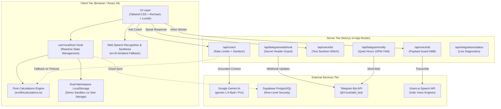

# YUVA SATHI — Technical Architecture & System Design

**YUVA SATHI (युवा साथी)** is architected as a resilient, client-first financial web application with serverless cloud extensions. It combines pure mathematical determinism on the client with secure cloud persistence and intelligent AI companions on the server.

---

## 1. High-Level Architecture Diagram



---

## 2. Architectural Boundaries & Principles

### A. The Deterministic Financial Core
Financial accuracy is paramount. AI models are prone to hallucinating arithmetic figures. To prevent this, YUVA SATHI implements strict architectural isolation:
1. **The Single Source of Truth:** `src/lib/calculations.ts` is a 100% pure TypeScript module with zero external dependencies.
2. **Deterministic Inputs:** Monthly allowance, recurring commitments, credit card dues, savings goals, and transaction history.
3. **Deterministic Outputs:** `safeToSpendToday`, `currentBalance`, `discretionaryFunds`, `spendingPace`, and `monthEndForecastBalance`.
4. **AI Read-Only Ingestion:** The AI Money Coach is supplied only with pre-calculated numbers from the deterministic core. It provides empathetic, context-aware student advice but is strictly prevented from calculating or modifying ledger values.

### B. Dual-Namespace Storage Engine
To accommodate immediate hackathon evaluator walkthroughs without forcing cloud registration:
- **Demo Namespace (`yuva_sathi_v1_demo_*`):** Pre-seeded with Rohan Sharma's realistic campus ledger (allowance, mess fees, hostel rent, chai/canteen expenses, credit dues).
- **User Namespace (`yuva_sathi_v1_user_*`):** Dedicated storage for real student data, synced to Supabase PostgreSQL when user credentials are provided.
- **Atomic Batching:** State changes write through `setStoredItems`, triggering a single `yuva_store_update` event to eliminate re-render cascades.

### C. Server-Side Integration Isolation
All external integrations are strictly isolated in Next.js App Router route handlers:
- **Google Gemini:** API keys remain server-side. Routes enforce sliding-window IP rate limiting (20 req/min) and an 8-second timeout abort controller.
- **Gnani.ai Voice:** Audio uploads are checked against a 5 MB buffer ceiling to protect container memory before streaming to Gnani endpoints.
- **Telegram Bot:** Uses webhook secret verification (`X-Telegram-Bot-Api-Secret-Token`) and single-use 15-minute token verification.

---

## 3. Data Flow: "Safe-to-Spend Today" Calculation

```
[ Monthly Pocket Money + Other Inflow ]
                    │
                    ▼
          [ Current Balance ]
                    │
                    ├─── Minus: Unpaid Essential Commitments (Mess, Rent, Books)
                    ├─── Minus: Credit Card Dues (Quarantined to avoid interest)
                    └─── Minus: Active Savings Reserves (Up to 30% of surplus)
                    │
                    ▼
        [ Discretionary Buffer ]
                    │
                    ▼  Divided by: Days Remaining in Current Cycle
                    │
         ==============================
         ⭐ Safe-To-Spend Today (₹/day)
         ==============================
```

If variable spending spikes, the spending pace shifts from `On Track` to `Fast` or `Critical`, and the AI Money Coach automatically surfaces actionable cost-cutting recommendations.
